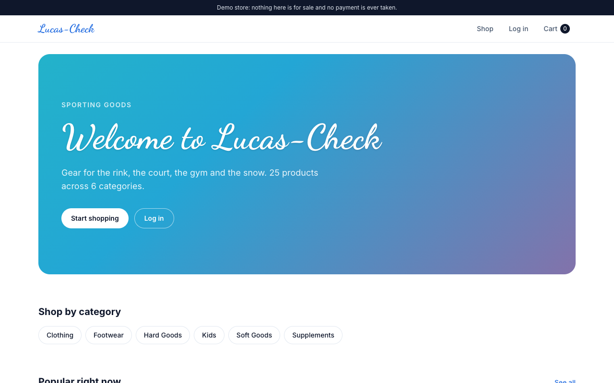
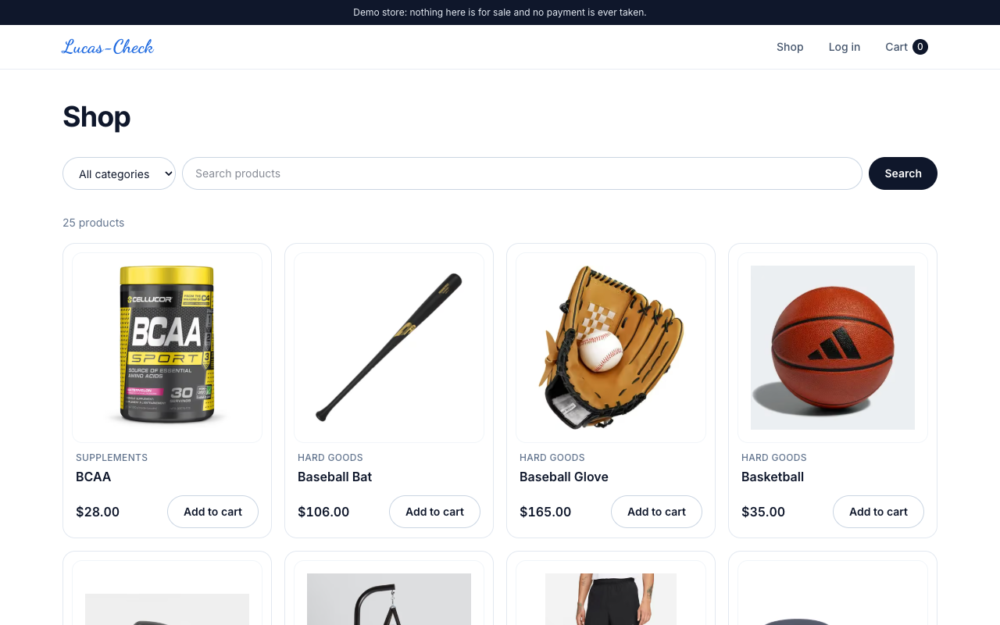
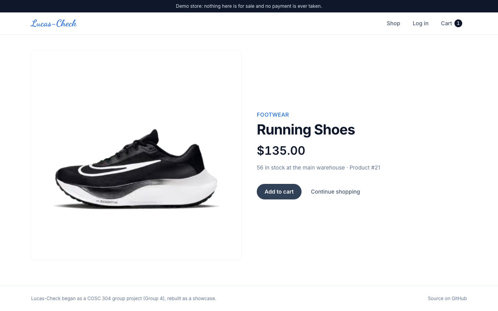
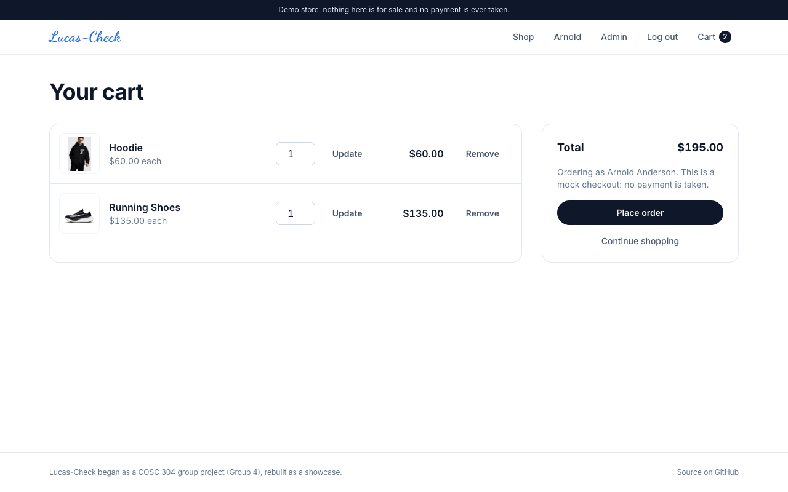
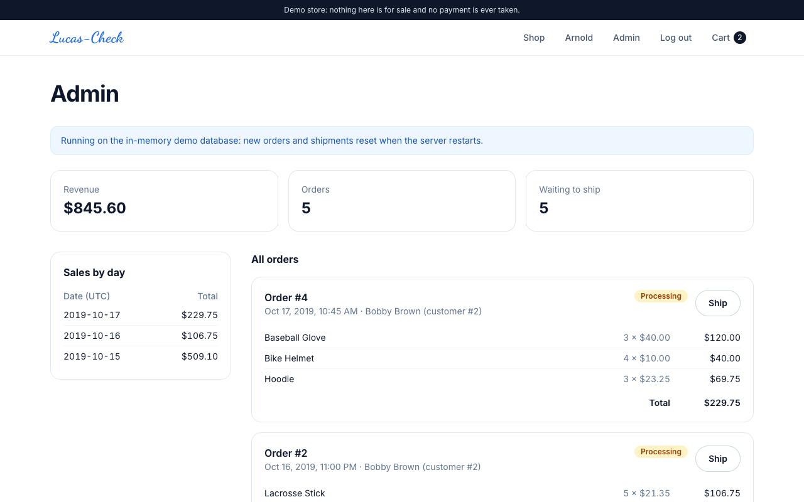
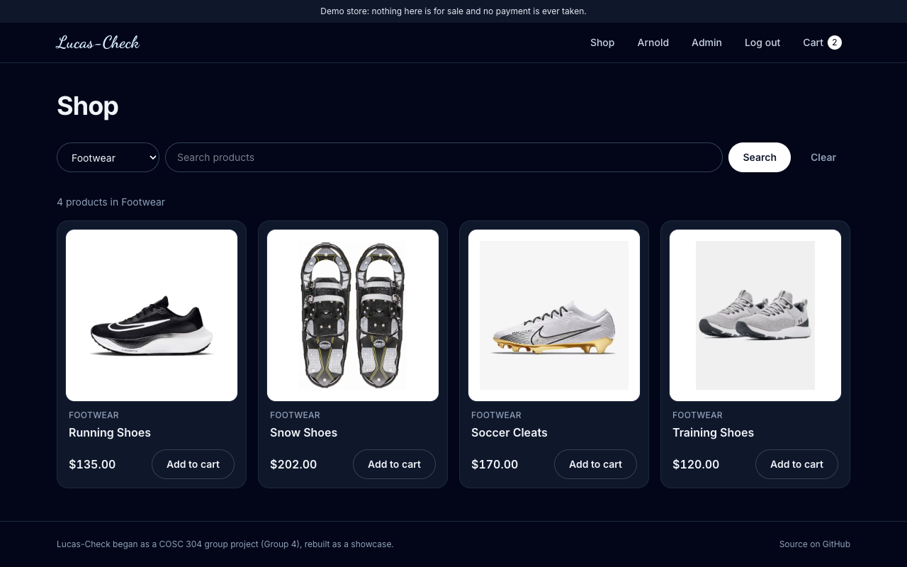
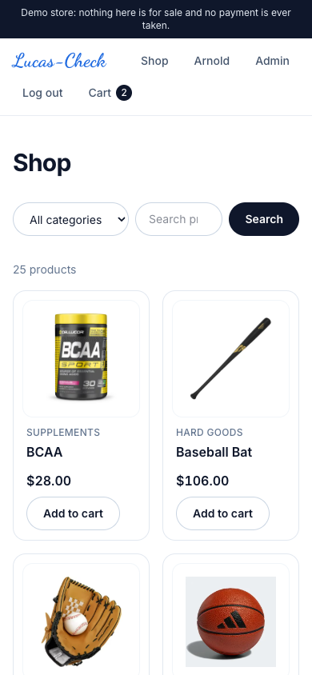

<p align="center">
  
</p>

<h1 align="center">Lucas-Check</h1>

<p align="center">
  A mock sporting goods store: browse gear, fill a cart, place orders and ship them from the warehouse.<br>
  A university group project, rebuilt on a modern stack as a showcase.
</p>

<p align="center">
  <a href="https://lucascheck.vercel.app"><b>▶︎ Open the live demo</b></a>
  &nbsp;·&nbsp; Next.js 16 · React 19 · Postgres &nbsp;·&nbsp; Deploys on Vercel
</p>

<p align="center">
  
</p>

> **This is a demo store.** Nothing is for sale, there is no payment step, and the accounts below
> are sample data.

---

## Contents

- [Features](#features)
- [Try it](#try-it)
- [Screenshots](#screenshots)
- [How it works](#how-it-works)
- [Deploying to Vercel](#deploying-to-vercel)
- [Running locally](#running-locally)
- [Project layout](#project-layout)
- [From the original to this version](#from-the-original-to-this-version)
- [Privacy](#privacy)
- [AI assistance](#ai-assistance)
- [Acknowledgements](#acknowledgements)
- [Licence](#licence)

## Features

| | |
|---|---|
| **Shop** | 25 products in six categories (Hard Goods, Soft Goods, Clothing, Footwear, Kids, Supplements), with search, a category filter and a page for each product showing live warehouse stock. |
| **Cart** | Add, change quantities, remove. The cart is kept in a cookie and priced from the database, so prices can't be edited in the browser. |
| **Accounts** | Log in to check out. Your account page shows your profile and every order you've placed, with its shipping status. |
| **Checkout** | Places the order in one database transaction and gives you a reference number. No payment is taken. |
| **Admin** | Revenue, order count and sales by day, every order with its items, and a **Ship** button that takes the stock out of the warehouse, or refuses and changes nothing if there isn't enough. |
| **Works anywhere** | Light and dark mode, phone to desktop, keyboard friendly. Old links (`listprod.jsp`, `product.jsp?id=4`, …) redirect to the new pages. |

## Try it

Open the [live demo](https://lucascheck.vercel.app) and log in with one of the sample accounts:

| Username | Password | Can |
|---|---|---|
| `arnold` | `test` | Shop, and use the **Admin** page (sales report, ship orders) |
| `bobby` | `bobby` | Shop; has two past orders |
| `beth` | `test` | Shop; has one past order |
| `candace`, `darren` | `password`, `pw` | Shop |

Unless a database is connected (see [below](#deploying-to-vercel)), the demo runs on an in-memory
database that starts fresh each time the server does, so feel free to place and ship as many orders
as you like.

## Screenshots

| | |
|---|---|
|  |  |
| **Shop** with search and categories | **Product** with live stock |
|  |  |
| **Cart** and checkout | **Admin**: sales and shipping |
|  |  |
| Dark mode | On a phone |

## How it works

| Layer | What it uses |
|---|---|
| **App** | [Next.js 16](https://nextjs.org) App Router with React 19 Server Components. Pages read the database on the server; forms post to Server Actions (`src/app/actions.ts`), so the site works even before its JavaScript loads. |
| **Styling** | Tailwind CSS 4. The animated four-colour gradient and the Dancing Script logo are carried over from the original site. |
| **Database** | Postgres. With `DATABASE_URL` set it connects through [`pg`](https://node-postgres.com) to any Postgres (Neon, Supabase, …). Without it, it runs [PGlite](https://pglite.dev), Postgres compiled to WebAssembly, in memory, so the demo needs no setup at all. Either way, the tables and sample data are created on the first request if they're missing. |
| **Sessions** | A signed, HTTP-only JWT cookie ([`jose`](https://github.com/panva/jose)). Nothing is stored on the server, so it works across Vercel's serverless instances. Passwords are hashed with bcrypt. |
| **Orders and shipping** | Placing an order and shipping one each run as a single transaction. Shipping only takes stock that is actually there (`quantity >= needed`), so two admins shipping at once can't oversell, and an order can only ship once. |

Health check: [`/api/health`](https://lucascheck.vercel.app/api/health) reports whether the database answers
and which kind it is.

## Deploying to Vercel

The repository is ready to import as is: `vercel.json` pins the framework to Next.js, so a project
first set up for the old static/JSP version builds correctly too.

1. **Import** the repository in Vercel (or push to a project that's already linked).
2. **Environment variables** (Project ▸ Settings ▸ Environment Variables):

   | Name | Needed | Value |
   |---|---|---|
   | `SESSION_SECRET` | Yes, for production | Any long random string: `openssl rand -base64 32` |
   | `DATABASE_URL` | No | A Postgres connection string. Leave it out to keep the self-resetting demo database. |

3. **Optional, for orders that persist:** add a Postgres database from the Vercel Marketplace
   (Neon has a free plan), which sets `DATABASE_URL` for you. The tables and sample data are created
   on the first request, or run `npm run db:setup` yourself.
4. Redeploy.

## Running locally

Requires Node.js 20.9 or later.

```bash
npm install
npm run dev          # http://localhost:3000, on the in-memory demo database
```

To use a real Postgres, copy `.env.example` to `.env.local` and fill in `DATABASE_URL`, then:

```bash
npm run db:setup              # create the tables and sample data (if missing)
npm run db:setup -- --reset   # drop everything and start over
```

Checks: `npm run lint`, `npm run typecheck`, `npm run build`.

## Project layout

| Path | Contents |
|---|---|
| `src/app/` | The pages: home, `products/` and `products/[id]`, `cart/`, `login/`, `account/`, `orders/[id]`, `admin/`, and `api/health`. `actions.ts` holds every form action (cart, log in/out, checkout, ship). |
| `src/components/` | Product and order cards, the login form, the ship button, shared buttons and notices. |
| `src/lib/db.ts` | The database: Postgres or PGlite behind one small query interface, set up on first use. |
| `src/lib/schema.ts` | Tables and sample data, ported from the original SQL Server script. |
| `src/lib/store.ts` | Every query: products, cart pricing, customers, orders, sales, placing and shipping orders. |
| `src/lib/session.ts`, `cart.ts` | The login cookie and the cart cookie. |
| `scripts/db-setup.ts` | `npm run db:setup`. |
| `public/img/` | Product photos. |
| `docs/` | Screenshots, the original course report and marking guide, and the original SQL Server script (`legacy-orderdb-sqlserver.ddl`). |

## From the original to this version

The original was a set of JSP pages on Tomcat with a SQL Server database in Docker. Vercel only
serves static files and JavaScript functions, so the deployed site answered every page with a
**404**: there was no `index.html` at the root, and JSP can't run there. The rebuild keeps every
feature and fixes what was broken along the way:

| Before | Now |
|---|---|
| JSP + Tomcat 9 + SQL Server 2019 in Docker | Next.js 16 + Postgres, serverless on Vercel |
| Database password `304#sa#pw` written into six pages | Connection string in an environment variable |
| Passwords stored and compared as plain text | bcrypt hashes |
| Name and price passed in the "Add to cart" link, so anyone could edit the price | Cart holds only product ids; prices always come from the database |
| Checkout asked you to type a customer id, so you could order as anyone | Checkout uses the logged-in account |
| "List All Orders" open to everyone; Admin open to any logged-in user | Orders only to their owner; Admin only to admins |
| Search text echoed into the page unescaped (XSS) | React escapes everything |
| Database errors printed into the page | Logged on the server; visitors see a friendly error page |
| Cart "Update Quantity" button broken (called a function that didn't exist) | Works |
| Search wrapped the term in `%` twice; "Add to cart" from the product list put the product's id in the cart as its name | Fixed |
| Shipping could take stock below zero under load, and an order could ship twice | Guarded in one transaction |
| Seed orders referenced products 28 and 29, which don't exist | Removed; totals recomputed |
| A hotlinked photo of a real person on the home page | Removed |

## Privacy

There are no analytics, trackers or third-party scripts. The site sets two cookies, both HTTP-only:
`lc_session` (your login, for a week) and `lc_cart` (your cart, for a month). Fonts are
self-hosted by Next.js at build time. The sample customer details are fictional.

## AI assistance

This rebuild was made with **[Claude Code](https://claude.com/claude-code)**, Anthropic's AI coding
assistant, as a pair programmer.

- **Who did what:** the author decided what to rebuild and how it should work and look. Claude
  ported the JSP pages to Next.js, wrote the database layer and the rest of the new code, and
  tested it.
- **How it was checked:** every page and form was driven end to end in a real browser: browsing,
  search, adding to and changing the cart, a failed and a successful login, placing an order,
  shipping it as admin and confirming the stock went down, and a non-admin being refused the
  Admin page. This ran against both the in-memory database and a real Postgres connection, plus
  type checks, lint and a production build.
- **Know the limits:** it's a portfolio demo, not an audited shop: there are no payments, and the
  sample accounts' passwords are public on purpose.

## Acknowledgements

Lucas-Check started as the term project for **COSC 304 (Introduction to Database Systems)** by
**Group 4**:

- **Dhairya Bhatia**
- **Jay Bhullar**
- **Sumer Mann**
- **Khalid Mahmoud**

The group designed the store, its categories and products, the database schema and the original
JSP site, built over four lab assignments (see the [project report](docs/COSC304-Report.pdf)). This
version is Dhairya's rebuild of that shared work on a modern stack, so it can live on as a
showcase: the store, its data and its look come from the group project. Thanks to the team, and
to the COSC 304 course staff, whose lab starter code the original pages grew from.

Product photos were collected by the group for the course project from retailers' public listings;
brand names in the photos belong to their owners.

## Licence

No licence has been chosen yet. The code began as a group project, so it isn't offered for reuse
until the group agrees on one. You're welcome to read it and try the demo.

---

<p align="center"><sub>COSC 304 · Group 4 · rebuilt 2026</sub></p>
